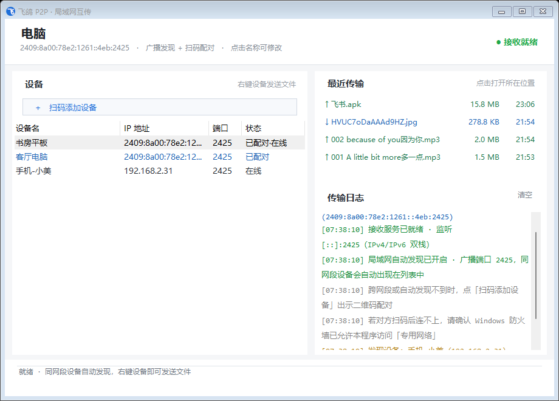
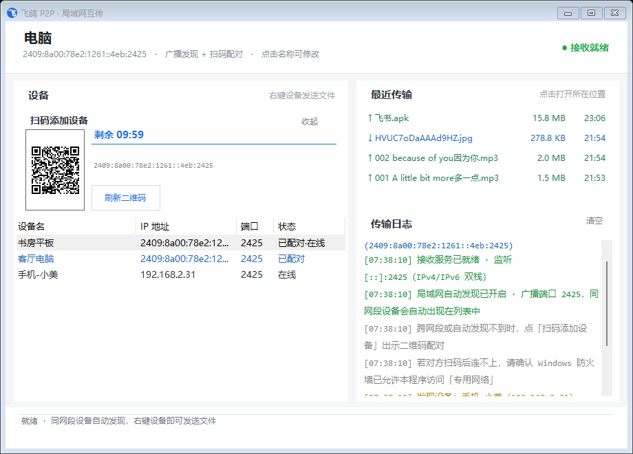

# 飞鸽 P2P · 局域网互传

一个纯点对点（P2P）的局域网文件传输工具，灵感来自 2005 年前后的「飞鸽传书」。PC（Windows）与 Android 手机安装本应用后，**同一网段会自动互相发现**；跨网段或用扫码**二维码配对**建立连接，之后直接互传文件，**不经过任何服务器、不加密**。支持 1GB 以内文件。

- **PC 端**：C# + WinForms，.NET 8，独立 exe
- **Android 端**：Kotlin + Jetpack Compose，minSdk 24（Android 7.0+）
- **通信**：UDP 广播自动发现 + 二维码配对（10 分钟有效、双向确认）+ TCP 点对点传输（TCP/UDP 端口 2425，IPv6/IPv4 双栈），协议见 [`shared/PROTOCOL.md`](shared/PROTOCOL.md)

---

## 两种发现方式

| 方式 | 适用场景 | 操作 |
|---|---|---|
| **UDP 广播自动发现** | 同一网段（家里/办公室同一个 Wi-Fi、同一交换机） | 零操作：对方打开程序就自动出现在列表；退出或离开网络 12 秒后自动消失 |
| **二维码配对** | 跨网段、公司网、路由器开了 AP 隔离 | 一方点「添加设备」出示二维码（10 分钟有效），另一方扫码，**双方各自确认** |

两路来源写进**同一个设备列表**，状态列显示 `刚配对` > `已配对·在线` > `已配对` > `在线`。同一台设备既配对过又在广播时只显示一行——判据是「设备名 + 端口」，且只在同名已配对设备恰好一台时合并，所以两台同型号手机不会被并错。合并后保留配对时的地址（IPv6 优先），广播只用来更新在线状态。

---

## 功能

- **局域网自动发现**：同网段设备每 2 秒广播一次，自动出现在列表里，无需任何操作；离线/退出时自动消失
- **二维码配对**：一方点「添加设备」出示二维码，另一方扫码 → 双方各自确认 → 设备进入列表（跨网段也能用）
- 二维码 10 分钟有效；刷新、收起、配对成功都会让旧码立即失效，且一码只能用一次
- 配对设备不依赖心跳，本次运行内常驻；广播设备超时则从列表移除
- 接收方先确认再接收：PC 上点「接收…」即弹出保存位置选择，选好才开始传输；拒绝会立刻通知对方
- 同名文件不覆盖，自动加 `(1)`、`(2)`
- 设备名可改，改完立刻广播新名字（同网段设备无需重启，二维码也用新名字）
- PC 右侧「最近传输」最多留 5 条，点一条即可在资源管理器中定位文件；下面是传输日志
- PC 关闭窗口只收进托盘（仍可接收文件），需从托盘菜单「退出」才真正结束
- 传输进度与日志；手机端以前台服务常驻，退后台/锁屏仍能收文件
- 跨网段可手动填 IP 直连（见 FAQ）

### 网页模式（PC 端，v2.2 新增）

给**没装飞鸽的朋友**一个浏览器入口：主界面点「🌐 网页模式」→ 服务启动 → 出示地址 + 二维码 + 6 位 PIN → 朋友用手机/电脑浏览器打开，输入昵称和 PIN 加入，即可双向传文件。零安装、不经过任何服务器。

- **入口与配对并列**：「＋ 扫码添加设备」给装了 App 的设备，「🌐 网页模式」给浏览器；配对流程一行未改
- **一次点击、三处联动**：地址文字 / 二维码 / 服务状态；PIN 与在线访客不受影响
- **IPv4 / IPv6 可切换**：默认 IPv4；本机没有可用 IPv6 时整个选项禁用，绝不显示对方连不上的地址
- **访客独立成页**：浏览器访客不进 P2P 设备列表（两者是不同的传输通道），只在网页模式窗口里管理
- **两层确认不变**：加入要 PIN；你发文件给访客→访客确认；访客上传→你确认（复用原接收框与「选保存位置」，Android 端才自动落默认目录）
- **群发**：勾选多位访客 + 选文件 → 逐人发 offer、各自 60 秒确认、独立传输，一人拒绝不影响他人
- **不踢人**：刷新 PIN 只挡新访客；关闭网页模式窗口服务仍运行，要停就点「停止服务」
- **连错 3 次自动换码**：访客连续输错 3 次 PIN，旧码立即失效、新码在窗口里高亮提示；成功加入或手动刷新后计数清零，全程不踢在线访客
- 默认端口 8080，被占用时自动往后找可用端口并在日志说明

> 实现说明：信令用 **SSE（EventSource）** 而不是 WebSocket——语义相同（服务端单向推送 + 自动重连），但省掉一层帧编解码；文件本体仍走普通 HTTP（下载流式返回、上传流式写 `.part` 后再改名），大文件不进内存。
>
> 状态：**仅 PC 端已实现**，Android 端暂未实现（见分支 `feature/web-mode-pc`）。

---

## 目录结构

```
.
├── shared/PROTOCOL.md      两端共用通信协议 v2.1（广播发现 + 二维码配对 + TCP 传输）
├── shared/QR_PAIR_UI.md    二维码配对的交互与界面设计（含实现记录与偏差说明）
├── shared/screenshots/     PC 端界面截图（自动发现 + 配对设备共存的列表）
├── UI-DESIGN.md            界面设计说明
├── pc/                     PC 端 C# 工程（FeigeP2P.csproj），app.ico 为程序图标
│   └── installer/          安装包定义（WiX v5）与打包脚本 build-msi.sh
├── android/                Android 工程（Gradle / Kotlin）
├── tools/icongen/          由「飞」字轮廓生成 ico 与 Android vector 的小工具
└── test/FeigeTest/         协议与配对闭环测试（C#，41 项）
```

---

## 界面

<p align="center">
  
  
</p>

左图是默认态：只有一个「＋ 扫码添加设备」入口，下面是设备列表（局域网发现与配对设备混排，状态列区分来源）。右图是点击入口后展开的配对面板：二维码、10 分钟倒计时（最后 60 秒转琥珀、过期转红）、本机地址与「刷新二维码」。收起面板会立即作废当前 token。

---

## 编译产物（已放在根目录）

| 文件 | 说明 |
|---|---|
| `飞鸽P2P-Setup-x64.msi` | **PC 安装包**（推荐），约 63 MB，双击安装，自带 .NET 运行时，装完有开始菜单/桌面快捷方式与卸载入口 |
| `FeigeP2P.exe` | PC 绿色版单文件，约 670 KB，免安装直接跑（需 .NET 8 桌面运行时） |
| `飞书.apk` | Android 安装包，约 17 MB，支持 Android 7.0+；装好后在手机上显示为「飞书」 |

两端图标一致：蓝色圆底 + 白色「飞」，字形取自微软雅黑粗体的真实轮廓。PC 的 `pc/app.ico` 与 Android 的 `ic_launcher_foreground.xml` 都由 `tools/icongen` 从同一份轮廓生成，改颜色或大小可重新跑一遍：

```bash
cd tools/icongen
dotnet run -c Release -- ../../pc/app.ico ../pathdata.txt   # 换 logo 色只需改 IconGen.Blue
```

Android 端安装后名称为「飞书」，包名仍是 `com.gelandesprung.ipfile`。

以上产物都由构建脚本生成，已加入 `.gitignore`（二进制不进版本库）。

重新生成：

```bash
# PC 安装包 → 根目录 飞鸽P2P-Setup-x64.msi（一条命令搞定，见下节）
bash pc/installer/build-msi.sh

# PC 绿色版 → 根目录单文件（需目标机器有 .NET 8 桌面运行时）
dotnet publish pc/FeigeP2P.csproj -c Release -r win-x64 \
  --self-contained false -p:PublishSingleFile=true -p:DebugType=none -o .

# Android 端 → 复制到根目录
cd android && ./gradlew assembleDebug
cp app/build/outputs/apk/debug/app-debug.apk ../飞书.apk
```

### PC 安装包（MSI）

双击 `飞鸽P2P-Setup-x64.msi` 即可：中文向导 → 许可 → 选择目录 → 安装 → 可勾选「立即运行飞鸽 P2P」。

- **当前用户安装**，默认装到 `%LOCALAPPDATA%\Programs\FeigeP2P`，**不需要管理员权限**
- 不装进 `Program Files` 是刻意的：程序把收到的文件存在安装目录的 `received\` 下，装进受保护目录后非管理员运行将无法写入
- 装完自动创建开始菜单与桌面快捷方式；在「设置 → 应用 → 已安装的应用」里可卸载
- 包内是**自包含单文件**，目标机器无需安装 .NET 8 运行时
- 版本号 2.1.0，与 `pc/FeigeP2P.csproj` 的 `<Version>` 一致；升级时新包会自动替换旧版（MajorUpgrade）

打包工具是 WiX v5（.NET 全局工具，一次安装）：

```bash
dotnet tool install --global wix --version 5.0.2
wix extension add -g WixToolset.UI.wixext/5.0.2
```

安装包定义在 `pc/installer/Product.wxs`，许可文本 `License.rtf` 由脚本生成；改版本号时同步 `Product.wxs` 的 `Version` 与 `RegistryValue Version` 两处。

---

## PC 端

### 编译

需要 .NET 8 SDK（本机构建环境：`D:\workbuddy\todo\tools\dotnet-sdk-8.0.428-win-x64`）。

```bash
cd pc
dotnet build -c Release
# 产物：pc/bin/Release/net8.0-windows/
```

日常运行请直接用根目录的 `FeigeP2P.exe`（单文件）。若目标机器**没有安装 .NET 8 运行时**，改用自包含发布：`dotnet publish -c Release -r win-x64 --self-contained true -p:PublishSingleFile=true`。

### 使用

- **自动发现**：同网段的手机/电脑开着本应用就会自动出现在左侧「设备」列表，状态显示「在线」，无需任何操作
- **扫码添加（跨网段兜底）**：点左侧「＋ 扫码添加设备」→ 展开二维码（10 分钟倒计时）→ 让对方用手机扫码并确认；对方允许后设备入列，面板自动收起
- **发文件**：在左侧「设备」列表右键目标 → 「发送文件…」→ 选文件（可多选，逐个发送）
- **收文件**：有人发来时会弹确认框，显示文件名/大小/来源 IP。
  - 点 **接收…** → 立刻弹出「选择保存位置」，选好目录/文件名后开始接收（默认收件夹是程序目录 `received/`）
  - 在选择框里点取消不算拒绝，会退回确认框继续等
  - 点「拒绝」则不接收，并**立刻通知对方被拒绝**；60 秒不操作也会自动拒绝
- **最近传输**：右上区域最多显示 5 条收/发记录（`↓` 收、`↑` 发），**点一下**就在资源管理器中选中该文件；文件已被移走时改为打开其所在目录
- **关闭窗口 = 收进托盘**：程序继续在后台接收文件，双击托盘图标可恢复窗口；**真正退出**请右键托盘图标 → 「退出飞鸽 P2P」
- **改设备名**：点顶部自己的名字 → 变成输入框 → 回车保存
- **复制 IP**：右键设备 → 「复制 IP 地址」
- **刷新设备**：右键设备（或列表空白处）→ 「刷新设备」，立即重发一次广播，不用等下一轮
- **移除设备**：右键设备 → 「从列表移除」；配对的设备需重新扫码，纯局域网发现的设备下一轮广播会重新出现
- **打开收件夹**：右键设备列表空白处 → 「打开收件夹」

### 网页模式使用步骤

1. 点左侧「🌐 网页模式」（与「＋ 扫码添加设备」并列，实心蓝那个）→ 服务启动，窗口显示地址、二维码和 6 位 PIN
2. 让朋友连你的热点或同一 WiFi，用浏览器扫二维码或手输 `http://你的IP:8080/`
3. 朋友填昵称 + PIN 加入；之后：
   - **你发给他**：在「在线访客」里右键某人 →「发送文件…」，或点「群发」勾选多人；他那边弹确认卡，点接收开始下载
   - **他发给你**：他在网页点「选择文件」→ 你这边弹熟悉的接收确认框 → 点「接收…」选保存位置 → 才开始收
4. 收完的文件进「最近传输」，点一下即可在资源管理器定位

窗口关掉服务仍在跑（主界面按钮会显示「运行中」或在线人数）；要停服务点窗口里的「停止服务」。端口被占时日志会说明改用了哪个端口，也可点窗口右下角「改端口」。

---

## Android 端

### 编译

需要 JDK 17 + Android SDK 35 + Gradle 8.9（本机环境在 `D:\workbuddy\todo\tools`）。

用 Android Studio 打开 `android/` 目录直接编译；或用命令行：

```bash
# 先设置 JAVA_HOME / ANDROID_HOME / GRADLE_USER_HOME 指向 tools 下对应目录
gradle -p android assembleDebug
# 产物：android/app/build/outputs/apk/debug/app-debug.apk
```

把 `app-debug.apk` 传到手机安装（需允许「安装未知来源应用」）。

### 使用

- 首次打开会请求「通知」权限（用于接收服务的常驻通知与接收确认），请允许
- **自动发现**：连同一个 Wi-Fi 的设备会自动出现在「设备」列表；标题右侧「刷新」可立即重发广播
- **添加设备（跨网段兜底）**：点「添加设备」→ 进入配对页
  - 「出示二维码」：让对方扫码，二维码 10 分钟有效，可刷新/收起
  - 「扫码配对」：首次使用会请求相机权限；扫到码后先确认对方身份，再由对方允许配对
  - 配对成功后自动返回主界面，对方出现在「设备」列表
- **发文件**：在「设备」里**长按**目标 → 底部面板 → 「发送文件…」→ 选文件
- **移除设备**：长按设备 → 「从列表移除」；配对设备仅本次运行有效，局域网设备离开网络后会自己消失
- **收文件**：有人发来时会请你确认
  - App 在前台：弹「收到文件」对话框，点「接收」或「拒绝」
  - App 在后台/锁屏：通知栏出现带「接收 / 拒绝」按钮的高优先级通知
  - 拒绝会立刻通知对方；60 秒未选择按拒绝处理
  - 同意后保存到公共下载目录 `飞鸽收件/`，通知栏显示进度
- **打开收到的文件**：在「最近传输」里点任意一条记录，用系统默认应用打开（发出的记录也可点开原文件）
- **改设备名**：右上角「设置」→ 第 1 项「设备名」→ 保存
- **服务**：设置页可手动启动/停止接收服务；正常情况下打开 App 会自动启动

> 注意：Android 10+ 后台限制较严，若要长时间离开 App 也能收文件，请保持接收服务的前台通知常驻（不要划掉通知），并允许电池优化白名单。

---

## 防火墙 / 网络

两端必须：
1. 网络可达：同一 Wi-Fi / 同一网段，或 IPv6 路由能互通
2. 放行 **TCP 2425**（文件传输与扫码配对）和 **UDP 2425**（自动发现）；Windows 首次运行会弹防火墙提示，选「允许访问专用网络」。只放行 TCP 也能用，只是只能靠扫码配对
3. 路由器若开启「AP 隔离 / 客户端隔离」，广播收不到，此时请用扫码配对

如果扫码后连不上：
- 看二维码下方的地址：应是全局 IPv6（`2xxx`/`3xxx` 开头）或内网 IPv4，**不应是 `fe80::`**；地址不对就点「刷新二维码」重新取
- 确认手机与 PC 在同一 Wi-Fi（不要连访客网络 / 公司隔离网），并关闭 AP 隔离
- 临时关闭 Windows 防火墙测试，确认不是端口被拦
- 手机端配对页会显示具体失败原因（超时 / 拒绝 / 不可达）

---

## FAQ

**Q：能跨网段/不同 Wi-Fi 传吗？**
可以，只要地址对扫码方 TCP 可达。二维码直接携带对方的 IP 与端口，不依赖广播，所以跨网段也能配对（前提是路由/防火墙放行 2425）。PC 没有摄像头，仍保留「手动输入 IP 直连」作为兜底。

**Q：为什么手机/电脑没自动出现在列表里？**
广播只能在同一网段内到达。常见原因：连了不同 Wi-Fi、路由器开了 AP 隔离、Windows 防火墙拦了 UDP 2425、或对方程序没启动。任一方点「刷新设备 / 刷新」可立即重发广播；仍不出现就用扫码配对。

**Q：支持多大文件？**
协议用 64KB 分块流式传输，不整体加载内存，实测 150MB 正常，1GB 无问题。再大也可以，只是耗时更长。

**Q：传输中断会留下半截文件吗？**
不会。接收时写 `.part` 临时文件，收齐校验后才改名；中断则删除临时文件。

**Q：为什么叫「P2P」？**
没有中心服务器，每台设备既能发也能收，互为对端——和当年的飞鸽传书一样。

---

## 一致性测试

`test/FeigeTest` 用 PC 端的真实协议类做本机闭环测试（广播包编解码与收包链路 + 二维码/HELLO 编解码 + IPv6 回环传输 + 中文名 + 重名不覆盖 + 150MB 大文件 + 配对成功/重放/刷新/过期/拒绝 + 网页模式的加入/信令/下行下载/上行两阶段落盘）：

```bash
cd test/FeigeTest
dotnet run
# 期望：64 通过 / 0 失败
```
