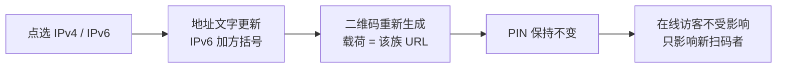

# 飞鸽 P2P · 网页模式交互设计（Web Guest Mode）

> 状态：**设计定稿 + PC 端已实现**（Android 端暂未实现，见分支 `feature/web-mode-pc`）
> 关联：[UI-DESIGN.md](../UI-DESIGN.md) 基础界面、[QR_PAIR_UI.md](QR_PAIR_UI.md) 二维码与两层确认、[PROTOCOL.md](PROTOCOL.md) 协议
> 设计原则：沿用现有浅色视觉规范；移动优先；**两层确认不合并**；无障碍以 WCAG 2.2 AA 为准
> 角色定义：**Host = 开服务的一端（手机或 PC，服务端/控制端）**，**Guest = 朋友（浏览器，零安装）**
> 场景定位：**熟人、面对面**——同一屋子里扫码连入、当场传文件；不做陌生人网络的安全模型，交互以"快、不易误操作"为先。

**实现记录（PC 端，2026-11-21）**

| 设计项 | 落地方式 | 与设计的差异 |
|---|---|---|
| 信令通道 | **SSE（EventSource）** | 原设计写 WebSocket。语义相同（服务端单向推送），SSE 自动重连、免去帧编解码，断线检测直接靠 TCP EOF |
| HTTP 服务 | 自己实现 HTTP/1.1（`TcpListener` 双栈） | 未用 `HttpListener`：后者绑非回环地址需管理员权限或 urlacl，而本程序是免安装免提权运行 |
| 端口占用（决策6） | 从配置端口起自动顺延最多 12 个，日志说明实际端口；窗口内可「改端口」 | 未弹窗打断，改为"自动顺延 + 可读提示" |
| 上传落盘 | 复用 `ReceiveConfirmDialog`（选保存位置）+ `.part` 临时文件 + 收齐改名 | 与 P2P 接收完全同一条代码路径 |
| 访客改名（决策3） | 加入时填一次，之后只读 | 与定稿一致 |

---

## 一、设计目标与范围

给现有 P2P 增加**第三种收发通道**：不装 App 的人，用浏览器访问 Host，即可与 Host 双向传文件。

| 能力 | 说明 |
|---|---|
| 访客列表 | 多个浏览器同时在线，Host 端以列表呈现 |
| 定向发送 | Host 选文件 → 指定某个访客 → 对方浏览器确认 → 保存 |
| **群发** | Host 勾选多个访客 + 选文件 → 逐个发 offer → 各自确认、各自传输（决策4） |
| 访客上传 | 浏览器选文件 → Host 弹确认 → 同意后按 Host 平台落盘（PC 选位置 / 安卓默认目录） |

**不做文件池、不做中转转发**（决策2）：访客上传的文件直接落盘为普通接收文件，与 P2P 收到的文件同等待遇；没有"池"这个中间态，也没有"从池里转发"的动作。Host 主动发文件时，文件来源是本机任意路径（群发/定向都如此），不需要池。

**核心心智不变**：仍是"设备列表 / 发送入口 / 传输状态三件套"，只是列表多了一类"网页访客"；发送入口仍收敛到列表项操作；接收仍是"先确认后落盘"。

**不在本次交互设计范围**：HTTP/WS 接口细节、Ktor/NanoHTTPD 集成、协议字节格式（另见工程实现文档）。

---

## 二、信息架构

### 2.1 Host 端（Android 竖屏 / PC 窗口）

在现有主界面上**只新增一个入口**，不出门即不打扰。复用「默认收起」哲学。

> **入口位置**：手机与 PC 完全一致——设备列表上方，与「＋ 添加设备」左右并列。手机上是两个等宽按钮；PC 上是左侧列表顶部的两个按钮（「＋ 扫码添加设备」虚线描边，「🌐 网页模式」实心蓝，更醒目）。点击后进入独立的网页模式页/面板，主界面本身不被改造。服务运行中时入口带小绿点，作为"正在对外提供服务"的唯一提示。

```
默认态（与现有主界面一致，仅多一个入口）
┌────────────────────────┐
│ 飞鸽            日志 设置│
├────────────────────────┤
│ 本机 [设备名] · IP      │
│ ＋ 添加设备   🌐 网页模式 │ ← 新增并列入口
├────────────────────────┤
│ 在线设备          2 台  │  ← 现有：P2P 设备（广播/配对）
│  PC 台式机-书房          │
│  手机 iPhone-小美 [刚配对]│
├────────────────────────┤
│ 最近传输                │  ← 网页收/发也混排记在这里
└────────────────────────┘

点击「🌐 网页模式」后（进入网页模式页）
┌────────────────────────┐
│ ‹ 网页模式        停止服务│
├────────────────────────┤
│ 访问地址                │
│ [IPv4] [IPv6]           │ ← 地址族切换，复用 RoleTabs 视觉
│  http://192.168.1.7:8080│ ← 可复制，随切换变化
│  ┌──────────────────┐  │
│  │   二维码（直达）    │  │ ← 扫码即打开访客页
│  └──────────────────┘  │
│  PIN 482913 [刷新]      │ ← 与地址族无关
├────────────────────────┤
│ 在线访客           2 人  │
│  [群发] ← 顶层入口        │ ← 决策4：进入多选群发模式
│  ┌──────────────────┐  │
│  │ 🌐 小美  · 空闲     │  │
│  │ 🌐 阿强  · 接收中   │  │
│  └──────────────────┘  │
│  长按访客 → 发送文件…    │ ← 单人定向发送
├────────────────────────┤
│ 传输状态（进度条）        │ ← 群发时可展开看每人进度
└────────────────────────┘
```

> PC 端同构：窗口内新增「🌐 网页模式」面板，群发多选改为复选框列表，其余一致。

### 2.2 浏览器 Guest 端（响应式网页，移动优先）

单页应用，四个状态互斥呈现：

```
状态① 加入页            状态② 等待/空闲页           状态③ 收到文件确认         状态④ 传输中
┌──────────────┐       ┌──────────────┐        ┌──────────────┐       ┌──────────────┐
│    飞鸽 🌐    │       │ 已连接 · 小美  │        │ 小美 发来文件    │       │ 正在接收      │
│              │       │ ● 等待主机发送 │        │ photo.zip      │       │ photo.zip     │
│ 你的昵称      │       │              │        │ 248 MB         │       │ ▓▓▓▓░░ 62%    │
│ [________]   │       │ [↑ 上传文件]  │        │              │       │ 154 / 248 MB  │
│ 访问 PIN     │       │              │        │ [接收] [拒绝]  │       └──────────────┘
│ [______]     │       │ 最近：        │        │ 剩余 00:58     │
│ [  进入  ]   │       │ ↑ 我上传 x.pdf│        └──────────────┘
└──────────────┘       └──────────────┘
```

> 访客昵称在加入时填一次，之后**不可改**（本次变更）：熟人面对面场景没有改名的必要，去掉入口减少干扰。

### 2.3 二维码的地址族切换（IPv4 / IPv6）

**为什么必须能切**：手机通常同时持有 IPv4（`192.168.x.x`）与全局 IPv6（`2409:…`）。朋友的浏览器在哪种网络，决定了哪条地址可达——同一 WiFi 多数走 IPv4；手机热点场景 IPv4 也常用；跨网段 / IPv4 被隔离时，全局 IPv6 反而可达。让 Host 现场切换，就是给"扫了码却连不上"提供即时兜底。

**切换控件（复用配对页 `RoleTabs` 视觉）**：

| 元素 | 规则 |
|---|---|
| 位置 | 访问信息卡内、地址文字**上方**，紧贴二维码 |
| 选项 | `[IPv4] [IPv6]`，选中态=蓝底白字；两个都可用时才显示两项 |
| 默认选中 | **IPv4 优先**（决策7 接受；浏览器访问 v4 兼容性最好，与配对码"IPv6 优先"相反，见 §2.4） |
| 地址格式 | IPv4 → `http://192.168.1.7:8080`；IPv6 → **`http://[2409:8a55::5]:8080`**（IPv6 字面量必须加方括号，否则端口无法分隔） |
| 可用性 | 某地址族取不到有效地址时**不显示该项**，地址行说明「本机无可用 IPv6」；不显示 `127.0.0.1` / `fe80::` 等不可达值 |

**切换时的联动（决策8：不联动已连接访客）**：



- **PIN 不随切换变化**：PIN 是访客凭证，与网络路径无关；切换只改变"新扫码者打开的 URL"。
- **在线访客不受影响（决策8 确认不联动）**：他们已通过握手连上，切换地址不下发、不重连、不踢人——熟人面对面，不能因为切一下地址就把在场的人打断。
- **二维码淡出→淡入** 240ms（复用现有刷新动画），地址文字同步切换，不闪烁。
- 无障碍：地址族不只靠颜色——选中段加粗+白字，未选段灰字；地址文字 `aria-live="polite"` 播报。

> 实现落点：`NetUtils.localIp()`（IPv6 优先、回退 IPv4）与 `localIpV4()` 不够用，需**新增"仅 IPv6"取法**（无全局/ULA v6 时返回空）供判可用；不要拿 `localIp()` 当 IPv6 用，否则无 v6 时会误拿到 v4 地址却套上方括号。

### 2.4 与原 UI 的结合：两个二维码如何共存

App 里有**两个二维码**，必须让用户一眼分清"扫哪个":

| | 配对二维码（现有） | 网页二维码（新增） |
|---|---|---|
| 所在位置 | 「＋ 添加设备」→ 配对页 →「出示二维码」Tab | 「🌐 网页模式」→ 访问信息卡 |
| 载荷 | `FG_QR\|1\|name\|ip\|port\|token` | `http://ip:port`（随地址族切换） |
| 扫码方 | 另一台**装了飞鸽 App** 的设备 | **任意浏览器**（零安装） |
| 扫完结果 | 对方入设备列表（配对确认） | 打开访客页（填昵称 + PIN） |
| 有效期 | token 10 分钟、一次性、收起即失效 | PIN 常驻直到刷新/停止 |
| 地址族 | 固定 IPv6 优先（现实现，决策9 确认不加切换） | **可切 IPv4 / IPv6**（§2.3） |

**结合三原则**：

1. **入口并列、各司其职（不改现有流程）**：「＋ 添加设备」「🌐 网页模式」并排，前者配对装 App 的设备（一行不改，保护已通过的 41 项测试），后者让浏览器连入。
2. **共用同一套出示组件、只换载荷与文案**：抽出通用 `QrDisplay`（二维码 + 载荷文字 + 复制 + 生命周期），两页共用，只在标题/说明文案上区分（「让另一台飞鸽设备扫」vs「让朋友用浏览器扫」）。
3. **地址族切换只挂网页面**（决策9 确认）：配对码维持 IPv6 优先不动；因共用 `QrDisplay`，日后若需要可低成本给配对码扩展。

> 防扫错：两页标题色带/图标不同（配对=设备图标灰蓝、网页=地球图标蓝），二维码下方固定一行小字说明扫码方类型，不靠位置记忆。

---

## 三、端到端交互流程

### 3.1 访客加入（对应现有"配对确认"层）

1. Host 点「🌐 网页模式」→ 此刻才**启动 Web 服务并生成 PIN**（与二维码"展开才生成"同哲学）。默认态无服务、无 PIN。
2. 访客浏览器打开访问地址（手输 IP:端口 或扫码二维码直达）。
3. 访客填**昵称 + PIN** → 点「进入」。
   - PIN 错：原地提示「PIN 不正确，请向主机索取」，不清空昵称。
   - PIN 对：进入等待页，Host 端「在线访客」列表出现该昵称，标「刚加入」约 5 秒。
4. **刷新 PIN（决策1：不踢人）**：旧 PIN 立即失效、新 PIN 显示，**只影响之后的新扫码者，已连接访客保持在线、连接不中断**。停止服务才全部断开。

> 访客加入 = 设备信任层。与 QR 配对 token 校验同定位；熟人场景下 PIN 主要防误入，不做强鉴权。

### 3.2 Host → 访客 定向发送（单人）

1. Host 在「在线访客」长按某人 → 底部面板 → 「发送文件…」→ 系统文件选择器（可多选，逐个传）。
2. 目标访客浏览器**自动弹出确认卡**（状态③）：文件名、大小、来源昵称、**60 秒倒计时**。
3. 访客点「接收」→ 切到状态④显示进度；点「拒绝」或超时 → 自动拒绝，Host 端收到「XXX 拒绝了文件」并记入传输记录。
4. 传完：访客浏览器用 `a.download` / File System Access API 落盘；Host 端记录"发送 完成"。
5. 一次只发给选中那一个，其他访客无感知。

### 3.3 群发（决策4：需要群发入口）

1. Host 在「在线访客」区点「**群发**」→ 进入多选模式：每个访客项左侧出现复选框，**默认全不选**（防误发）。
2. 勾选目标 → 顶部显示「已选 N 人」→ 点「发送文件…」→ 选本机文件（可多选）。
3. 对每个选中访客**逐个发 offer**（并行等待各自确认，不串行阻塞）：每个访客独立弹确认卡、独立 60 秒窗口、独立传输。
4. **一人拒绝/超时不影响其他人**；Host 端传输状态可展开看每人结果（已接收 N / 拒绝 M / 传输中 K）。
5. 每个结果各记一条传输记录。

> 群发 = "选 N 个人 + 选 M 个文件 → 给每人发这 M 个文件（逐个）"，复用单人发送的全部环节，只是把目标从一个变成多个。

### 3.4 访客 → Host 上传（决策2：无文件池）

1. 访客在等待页点「↑ 上传文件」→ 浏览器文件选择器。
2. **两阶段**（避免浏览器把整包一次性推过来导致无法先确认）：
   - ① 访客先发 `offer{文件名,大小,访客昵称}`，Host 弹**接收确认框**（复用现有 `PendingRequest`：前台对话框 / 后台高优先级通知，接收/拒绝，60 秒超时）。
   - ② Host 同意后访客才流式上传。**落盘完全复用现有接收行为，按 Host 平台分流（决策2）**：
     - **Host 是 PC**：确认框沿用现有「接收…」→ 弹「选择保存位置」，用户选好目录/文件名后才开始传（取消保存对话框不算拒绝，退回确认框）。
     - **Host 是 Android**：同意后自动保存到公共 Download 目录下的 `飞鸽收件/`（现有默认位置），通知栏显示进度。
     - 两者都保留 `.part` 临时文件 → 收齐改名 → 同名不覆盖。
3. Host 拒绝/超时 → 访客端提示「主机拒绝了文件」，不产生磁盘文件。
4. 完成后文件就是一条普通接收文件，进「最近传输」，**不进任何"池"**。

> 仍是两层确认：加入 PIN（信任）→ 上传接收确认（每文件）。落盘策略与 P2P 接收完全一致，用户无需学新规则。

---

## 四、状态机

### 4.1 网页服务生命周期（对齐二维码生命周期）

| 状态 | 触发 | 界面表现 |
|---|---|---|
| **停止（默认）** | 启动 / 点「停止服务」 | 主界面只有「🌐 网页模式」入口，无 PIN、无访客 |
| 运行中（Live） | 点入口进入网页模式页 | 访问地址 + 二维码 + PIN 可见；PIN 长期有效直到刷新/停止 |
| 刷新 PIN（Rotated） | 点「刷新 PIN」 | 旧 PIN 失效、新 PIN 显示；**在线访客保留（决策1/8 不踢人）** |
| 停止（Stopped） | 点「停止服务」/退出 | 服务关闭，所有访客断开，PIN 作废；已落盘文件不受影响（本就没有池） |

### 4.2 访客连接状态

| 状态 | 判定 | 界面表现 |
|---|---|---|
| 刚加入 | 通过 PIN 校验 <5 秒 | 列表项标「刚加入」高亮 |
| 空闲 | WS 连接正常 | 绿色圆点 · 空闲 |
| 接收中 / 上传中 | 有活跃传输任务 | 列表项显示进度文字 |
| 离线 | WS 断开 | **即时移除**（关页即走，Unlike P2P 常驻） |

> 与 QR 模式"会话内常驻"不同：浏览器访客是真实连接，断开即移除更诚实。

### 4.3 传输任务状态（两端一致）

`offer → pending(等确认 60s) → transferring → done | rejected | timeout | aborted`

- 群发时每个目标各自持有独立状态机，互不影响。
- 任一异常断开：清理 `.part`，Host 与访客端都收到失败提示。

---

## 五、视觉规范

### 5.1 色彩（与 QR_PAIR_UI.md §4.1 完全一致，仅浅色 · 决策5）

| 用途 | 色值 | 网页端说明 |
|---|---|---|
| 主色 / 强调 | `#1E6FD9`（蓝） | 主按钮、链接、二维码边框、进度条 |
| 成功 / 在线 | `#1E9E4A`（绿） | 「接收」「已连接」「完成」 |
| 失败 / 拒绝 | `#C62828`（红） | 「拒绝」、PIN 错误、失败 |
| 警告 / 倒计时 | `#B8860B`（琥珀） | 确认卡剩余 <15 秒 |
| 页面背景 | `#FAFAFA` | 网页端全局 |
| 卡片 | `#FFFFFF` | 卡片、确认弹层 |
| 分隔线 | `#E8EAED` | 0.5px 细边框 |
| 次要文字 | `#888888` | 地址、提示（≥11px） |
| 主文字 | `#1C2026` | 标题与正文 |

> 仅浅色主题，不做深色切换（决策5）。对比度：主文字 on 白 ≈ 15.8:1；蓝 ≈ 4.6:1（AA 正文 4.5:1）。语义色均配文字标签。

### 5.2 字体刻度

沿用系统 sans（微软雅黑 / Segoe UI / Roboto；网页端 system-ui 栈）：

| 层级 | 字号 | 字重 | 用途 |
|---|---|---|---|
| 页面标题 | 20px（网页）/ 15px（App 标题栏） | 500 | 「飞鸽 · 网页传文件」 |
| 区块标题 | 14px | 500 | 「在线访客」 |
| 正文 | 13–14px | 400 | 说明、按钮、文件名 |
| 辅助 | 11–12px | 400 | IP、倒计时、提示 |
| 倒计时数字 | 14–16px `tabular-nums` | 500 | 等宽数字 |

访问地址用等宽字体 `Consolas / monospace`，`word-break: break-all`。

### 5.3 断点（移动优先）

| 断点 | 宽度 | 布局 |
|---|---|---|
| 基准 | 320px | 单列，卡片通栏 |
| sm | ≥576px | 单列，内容最大宽 480px 居中 |
| md/lg | ≥768px | 访客页居中卡片；Host 管理页双列（访问信息 / 访客+传输） |

网页访客页桌面端**不超过 480px 宽居中**——它是"收文件的小工具"，不是后台系统。

### 5.4 间距与圆角

- 8px 基线：卡片内边距 16px，区块间距 12–16px。
- 圆角：卡片 12px，按钮 8px，手机外框 20px。
- 边框 0.5px；无阴影堆叠。

---

## 六、组件清单与状态

### 6.1 Host 端

| 组件 | 状态 |
|---|---|
| `WebModeEntry` 网页模式入口 | 默认（与"添加设备"并列）/ 服务运行中（小绿点） |
| `AccessInfoCard` 访问信息卡 | 地址族切换 + 地址 + 二维码 + PIN；刷新 PIN / 复制地址 / 停止服务 |
| `AddressTabs` 地址族切换 | 复用 `RoleTabs` 视觉；IPv4（默认选中）/ IPv6；仅可用项显示；切换不动 PIN 与在线访客 |
| `QrDisplay` 二维码出示组件 | **配对页 / 网页页共用**；二维码+载荷文字+复制+淡入淡出；两处仅标题/文案不同 |
| `GuestList` 在线访客列表 | 空态 / 列表（刚加入·空闲·接收中·上传中）/ 长按操作面板 / **群发多选模式** |
| `GuestActionSheet` | 「发送文件…」「断开此访客」 |
| `GroupSendBar` 群发入口 | 顶层「群发」按钮 → 多选模式「已选 N 人 + 发送文件…」→ 逐人 offer |
| `TransferStatus` 传输状态 | 单人进度条；群发时可展开为每人一行（已接收/拒绝/传输中） |
| `ReceiveConfirmDialog` | **复用现有** `PendingRequest` 确认框（前台）/ 通知（后台）；PC 带回保存位置 |

### 6.2 浏览器 Guest 端

| 组件 | 状态 |
|---|---|
| `JoinForm` 加入表单 | 默认 / PIN 错误提示 / 提交中 |
| `IdlePanel` 等待页 | 已连接 + 状态 + 「上传文件」+ 最近传输（昵称加入时定，之后只读） |
| `IncomingOfferCard` 收到文件卡 | 默认 / 倒计时<15s 转琥珀 / 接收中 / 已拒绝 |
| `TransferProgress` | 进度条 + `done/total` + 百分比 |
| `UploadFlow` | 选文件 → 等主机确认（转圈）→ 上传中 → 完成 |
| `Toast` | PIN 错误、主机拒绝、传输失败、离线 |

### 6.3 微交互参数（仅 transform / opacity）

- 按钮悬停 `scale(1.05)` 150ms；点击 `scale(0.97)` 100ms。
- 网页模式页进入：`translateX` 滑入 200ms（Android `AnimatedVisibility` / 网页 `@keyframes`）。
- 确认卡出现：`opacity 0→1` + `translateY(8px→0)` 180ms。
- 进度条宽度随字节数更新，每秒刷新，不额外动画。
- 倒计时 <15s 数字转琥珀并加「即将超时」文字，不闪烁。
- 所有动画包裹 `@media (prefers-reduced-motion: no-preference)` / 系统"减少动态效果"。

---

## 七、无障碍检查清单（WCAG 2.2 AA）

- [ ] 二维码 `` 提供 alt（「网页访问二维码」）+ 可复制地址文本作为等价替代。
- [ ] 倒计时不仅靠颜色：<15s 同时追加「即将超时」文字。
- [ ] PIN 输入框 `inputmode="numeric"` + `autocomplete="one-time-code"`，label 关联。
- [ ] 确认卡「接收/拒绝」键盘可达、焦点可见；Tab 顺序 拒绝 → 接收（拒绝优先防误操作）。
- [ ] 群发复选项有明确 label + 选中状态（勾选符号，不只靠颜色）；「已选 N 人」实时播报。
- [ ] 所有可点击区域 ≥ 44×44pt（网页按钮 min-height 44px，Android 48dp）。
- [ ] 语义色（红/绿/琥珀）均配文字标签。
- [ ] 进度同时用文字百分比表达，不只靠色条。
- [ ] 页面 `lang="zh-CN"`，标题层级 h1→h2 正确；访客页含 sr-only 摘要。
- [ ] 传输状态变化用 `aria-live="polite"` 播报（"收到文件 photo.zip"）。
- [ ] 主文字对比度 ≥4.5:1；次要文字 ≥11px 且仅用于辅助信息。

---

## 八、与现有功能的整合映射

| 现有元素 | 处置 | 改造后 |
|---|---|---|
| 主界面「在线设备」列表 | **保留不变** | 仍显示 P2P 设备；网页访客在独立网页模式页，不混入 |
| 「＋ 添加设备」入口 | **保留** | 右侧并列新增「🌐 网页模式」入口 |
| 接收确认 `PendingRequest` + 通知 | **复用** | 访客上传走同一套；PC 带回保存位置、安卓走默认目录；`peerIp` 显示访客昵称 |
| 落盘 `NonOverwritePath` / `createReceiveStream` | **直接复用** | 上传文件按 Host 平台落盘（PC 选位置 / 安卓默认 `飞鸽收件/`），`.part`+改名+不覆盖原样；**无文件池、无池子目录** |
| 进度 `Progress` / `setProgress` | **复用** | 方向枚举新增 `UPLOAD`（访客→Host）；群发为多个目标各上报 |
| 传输记录 `TransferRecord` | **复用** | 新增方向标签；网页收/发与 P2P 混排在"最近传输" |
| 文件选择器 `ACTION_OPEN_DOCUMENT` | **复用** | Host 发文件/群发选文件、访客网页 `<input type=file>` 各取所需 |
| 前台服务 `ReceiveService` | **扩展** | 顺带承载 Web Host；停止网页服务不影响 P2P 接收 |
| 二维码生成 `QrUtils` / `QrCode.cs` | **复用** | 同一渲染函数；配对页编 `FG_QR`，网页页编 URL（IPv6 加方括号） |
| 出示二维码面板 | **抽出共用 `QrDisplay`** | 二维码+文字+复制+生命周期两处共用；地址族切换只挂网页页（决策9） |
| 地址获取 `NetUtils` | **扩展** | 新增"仅 IPv6"取法供切换判可用；配对码仍走原 `localIp()` 不动 |

> 结论：改动集中在"新增网页模式页 + Guest 网页 + `QrDisplay` 抽取 + 群发多选 + 少量状态扩展"；发现、配对、发送、接收、落盘、进度、记录全部复用，无文件池、无中转层。

---

## 九、决策记录（9 项已全部确认）

| # | 议题 | 结论 |
|---|---|---|
| 1 | PIN 刷新是否踢人 | **不踢人**：旧 PIN 作废，已连接访客保持在线 |
| 2 | 文件池 / 上传落盘 | **不要文件池、不做中转转发**；上传直接落盘——PC 选保存位置、安卓自动存默认 `飞鸽收件/` |
| 3 | 访客改名 | **不改**（本次变更）：昵称加入时填一次，之后只读；熟人面对面无需改名，减少界面干扰 |
| 4 | 群发 | **需要群发入口**：Host 多选访客 + 选文件 → 逐人 offer、各自确认、互不影响 |
| 5 | 深色主题 | **仅浅色**，不做切换 |
| 6 | 端口占用 | **同意**默认 8080、占用时提示改端口，地址/二维码同步更新 |
| 7 | 地址族默认项 | **接受**网页面默认 IPv4、配对码维持 IPv6 优先（两者不同） |
| 8 | 地址族切换联动访客 | **不联动**：切换只影响新扫码者，在线访客不下发、不重连 |
| 9 | 配对码加地址族切换 | **不加**：配对码维持 IPv6 优先，保护已通过的配对流程与 41 项测试 |

---

确认以上设计后即可进入编码阶段。
